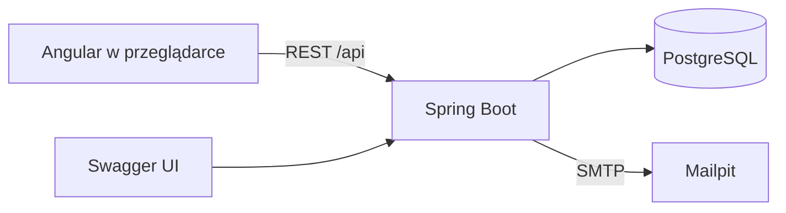

# TireShop — internetowy sklep z oponami

TireShop to aplikacja sklepu internetowego umożliwiająca zakup opon jako gość lub zalogowany klient. Obejmuje katalog z filtrami, koszyk, składanie zamówień, symulator płatności oraz panele klienta, pracownika i administratora.

Frontend powstał w **Angularze**, a backend w **Javie i Spring Boot**. Dane są przechowywane w **PostgreSQL**. Angular komunikuje się z rzeczywistym REST API — ceny, dostępność, uprawnienia, płatności i statusy zamówień są sprawdzane po stronie backendu.

Projekt został przygotowany na zajęcia z budowania aplikacji internetowych. Wykorzystuje zasady omawiane na przykładach ExpressJS, dostosowane do Springa. Płatności są symulowane, a poczta w środowisku demo trafia do lokalnego podglądu Mailpit.

## Spis treści

- [Uruchomienie w jednej komendzie](#uruchomienie-w-jednej-komendzie)
- [Dane demo i krótki scenariusz prezentacji](#dane-demo-i-krótki-scenariusz-prezentacji)
- [Funkcjonalności i role](#funkcjonalności-i-role)
- [Przebieg zakupu i reguły sklepu](#przebieg-zakupu-i-reguły-sklepu)
- [Zastosowane technologie](#zastosowane-technologie)
- [Architektura i organizacja kodu](#architektura-i-organizacja-kodu)
- [Najważniejsze rozwiązania techniczne](#najważniejsze-rozwiązania-techniczne)
- [Praca lokalna](#praca-lokalna)
- [Testy i ciągła integracja](#testy-i-ciągła-integracja)
- [Zakres wersji demonstracyjnej](#zakres-wersji-demonstracyjnej)
- [Dokumentacja szczegółowa](#dokumentacja-szczegółowa)

## Uruchomienie w jednej komendzie

### Wymagania

- Docker z Docker Compose **2.20 lub nowszym**; na Windows można użyć Docker Desktop z kontenerami Linux.
- Uruchomiony silnik Dockera oraz wolne porty `4200`, `8081` i `8026`.
- Internet podczas pierwszego budowania, aby pobrać obrazy i zależności.

Do uruchomienia całego demo nie trzeba instalować lokalnie Javy, Mavena ani Node.js.

### Start

Otwórz terminal w głównym katalogu projektu, w którym znajduje się plik `compose.yaml`, i wykonaj:

```sh
docker compose up
```

Compose buduje frontend i backend, uruchamia PostgreSQL oraz Mailpit, wykonuje migracje bazy i przygotowuje dane demonstracyjne. Poczekaj na zakończenie budowania i uruchomienie backendu — pierwsze uruchomienie może potrwać kilka minut.

| Element | Adres |
|---|---|
| Sklep i panele użytkowników | [http://localhost:4200](http://localhost:4200) |
| Swagger UI — interaktywna dokumentacja API | [http://localhost:8081/swagger-ui/index.html](http://localhost:8081/swagger-ui/index.html) |
| Specyfikacja OpenAPI | [http://localhost:8081/v3/api-docs](http://localhost:8081/v3/api-docs) |
| Stan backendu i połączenia z bazą | [http://localhost:8081/actuator/health](http://localhost:8081/actuator/health) |
| Mailpit — podgląd wiadomości | [http://localhost:8026](http://localhost:8026) |

### Konta demonstracyjne

| Rola | E-mail | Przykładowe zastosowanie |
|---|---|---|
| Klient | `customer@demo.test` | Zakup, edycja adresu, historia zamówień. |
| Klient z rozbudowaną historią | `history@demo.test` | Paginacja zamówień i płatności; zakup bez zapisanego adresu. |
| Pracownik | `employee@demo.test` | Produkty, magazyn i realizacja zamówień. |
| Administrator | `admin@demo.test` | Ceny, dopuszczenie do sprzedaży i zarządzanie kontami. |

Wspólne początkowe hasło jest generowane przy pierwszym starcie i zapisywane w **`.demo/password.txt`**. Nie ma stałego hasła w kodzie. Można też zarejestrować własnego klienta lub kupić jako gość.

Jeśli baza ma już administratora, demo wykorzystuje jego konto bez zmiany hasła; użyj dotychczasowych danych logowania. Hasła zmienione podczas prezentacji pozostają zachowane.

### Zatrzymanie i ponowne uruchomienie

- `Ctrl+C` zatrzymuje aplikację uruchomioną w terminalu.
- `docker compose up -d` uruchamia ją w tle; `docker compose stop` zatrzymuje usługi.
- Po zmianach w kodzie użyj `docker compose up --build`, aby przebudować obrazy.
- `docker compose logs -f backend` pokazuje logi backendu.

PostgreSQL przechowuje dane w wolumenie projektu Compose `tireshop-demo`. Katalog `.demo/` zawiera hasło początkowe i trwałe sekrety — zachowaj go razem z bazą. Zwykłe zatrzymanie kontenerów nie usuwa danych. Nie używaj `docker compose down -v`, jeśli chcesz je zachować.

### Aktualizacja istniejącego demo

Po pobraniu zmian uruchom z głównego katalogu:

```sh
docker compose up --build
```

Seed rozpoznaje wykonane wersje i dodaje brakujące przykłady jednorazowo. Rozszerzenie `presentation-v2` dodaje dziewięć produktów, konto `history@demo.test` oraz nowe zamówienia, zachowując wcześniejsze konta, ceny, koszyki i zamówienia. Nie trzeba usuwać bazy ani plików `.demo`. Przy uruchamianiu z IDE/Mavena nowe konta wymagają ponownego ustawienia `DEMO_PASSWORD`; Compose przekazuje je z istniejącego pliku automatycznie. Zajęty adres nowego konta powoduje przerwanie aktualizacji, zamiast przejęcia konta.

## Dane demo i krótki scenariusz prezentacji

Poniższe liczby dotyczą świeżej bazy, przed własnymi zakupami i zmianami podczas prezentacji.

| Dane | Co można pokazać |
|---|---|
| 24 produkty, w tym 21 w publicznym katalogu | Filtry czterech producentów, trzech rozmiarów i wszystkich sezonów, sortowanie oraz paginację. |
| `Demo 13`, `Demo 14`, `Demo 15` | Odpowiednio brak ceny, wyłączenie ze sprzedaży i zerowy stan magazynowy. |
| `customer@demo.test` | Zapisany adres, koszyk z 3 sztukami oraz 6 zamówień reprezentujących wszystkie statusy. |
| `history@demo.test` | Brak adresu w profilu, 21 zamówień oraz opłacone zamówienie z 21 próbami płatności: odrzucenia, anulowania i sukces. |
| Historia magazynu `Demo 16` | 23 wpisy: przyjęcie, korekty dodatnie i ujemne oraz wydania po zapłacie. |
| 3 zamówienia gości | Dwa opłacone z linkami śledzenia w Mailpit oraz jedno anulowane. |
| 30 zamówień i 50 wpisów audytu | Paginację zamówień oraz dziennik utworzeń i anulowań z filtrowaniem. |

Proponowana kolejność pokazu:

1. **Gość:** wybierz oponę, przejdź przez koszyk i adres do symulatora. Odrzuć próbę, ponów płatność i potwierdź sukces. Otwórz link śledzenia oraz wiadomość w Mailpit.
2. **Klient:** dodaj sztukę do koszyka gościa i zaloguj się jako `customer@demo.test`. Na świeżym demo scalenie z trzema zapisanymi sztukami daje cztery sztuki i darmową dostawę. Pokaż też edycję adresu i historię zakupów.
3. **Historia płatności:** zaloguj `history@demo.test`, otwórz zamówienie opłacone (`PAID`) i wybierz **Pokaż historię płatności**. Przejdź na drugą stronę wyników.
4. **Pracownik:** w panelu otwórz `Demo 16` i historię magazynu. Następnie pokaż dostawę towaru oraz realizację zamówienia z numerem przesyłki.
5. **Administrator:** ustaw cenę i dopuszczenie do sprzedaży, otwórz **Dziennik zdarzeń**, pokaż filtry i kolejne strony. Zaproś nowego pracownika lub zainicjuj reset hasła, a wiadomość otwórz w Mailpit.

Nieopłacone przykładowe zamówienia wygasają po **15 minutach**; restart nie odnawia rezerwacji. Rejestrację, zaproszenie pracownika, reset hasła i scalanie koszyków wykonuje się podczas pokazu. Link śledzenia gościa nie daje dostępu do historii płatności — tę pokaż w kontekście nowego zakupu w tej samej karcie. Pełny scenariusz i zasady aktualizacji: [profil demo](docs/demo.md).

## Funkcjonalności i role

| Użytkownik | Dostępne funkcje |
|---|---|
| Gość | Katalog i szczegóły opon, filtry rozmiaru/sezonu/producenta, sortowanie cen, paginacja, koszyk, zakup bez konta, symulator płatności i śledzenie opłaconego zamówienia przez specjalny link. |
| Klient (`CUSTOMER`) | Rejestracja i logowanie, własny koszyk, scalenie koszyka gościa po zalogowaniu, edycja danych i adresu, zakup, historia i szczegóły własnych zamówień, status i numer przesyłki. |
| Pracownik (`EMPLOYEE`) | Dodawanie i edycja parametrów oraz zdjęcia produktu, przyjęcia i korekty magazynowe, historia magazynu, przegląd zamówień i danych dostawy, obsługa realizacji i numeru przesyłki. |
| Administrator (`ADMIN`) | Ustalanie cen, dopuszczanie i wycofywanie produktów ze sprzedaży, zapraszanie pracowników, inicjowanie resetu hasła klienta/pracownika oraz dziennik zdarzeń z filtrem i paginacją. |

Pracownik nie ustala cen. Administrator nie dziedziczy automatycznie uprawnień pracownika. Publiczna rejestracja tworzy wyłącznie konto klienta. Administrator otwiera **Panel personelu → Dziennik zdarzeń**, pracownik **Opony → wybrana opona → Pokaż historię magazynu**, a klient lub gość **szczegóły zamówienia → Pokaż historię płatności**. Wszystkie trzy widoki korzystają z API, mają paginację i odświeżanie. Publiczny link śledzenia gościa nie udostępnia historii płatności.

## Przebieg zakupu i reguły sklepu

1. Klient wybiera opony z katalogu i dodaje odpowiednią liczbę sztuk do koszyka.
2. Przechodzi do zakupu jako gość albo loguje się na konto. Koszyk gościa można połączyć z koszykiem konta.
3. Podaje kontakt i adres lub sprawdza dane pobrane z profilu. Widzi aktualne podsumowanie produktów, dostawy i całej kwoty.
4. Kliknięcie **„Zapłać”** tworzy zamówienie i rezerwuje towar na **15 minut**.
5. Symulator pozwala wybrać sukces, odrzucenie lub anulowanie próby płatności. Backend zapisuje wynik.
6. Po zapłacie klient śledzi zamówienie w swoim panelu, a gość otrzymuje link na ekranie potwierdzenia i w wiadomości e-mail.
7. Pracownik realizuje zamówienie, uzupełnia numer przesyłki i potwierdza doręczenie.

```text
PENDING_PAYMENT → PAID → PROCESSING → SHIPPED → DELIVERED
       ↓
   CANCELLED
```

Najważniejsze reguły:

- Ceny są podawane brutto w **PLN**. Dostawa kosztuje **20 zł dla 1–3 sztuk** i jest **bezpłatna od 4 sztuk**, niezależnie od modeli i producentów.
- Koszyk nie rezerwuje towaru. Nieopłacone zamówienie można anulować; po wygaśnięciu rezerwacji zostaje anulowane automatycznie.
- Odrzucenie lub anulowanie próby płatności pozwala ponowić ją do pierwotnego terminu rezerwacji, bez jego przedłużania.
- Backend oblicza kwoty i ponownie sprawdza dostępność. Zmiana ceny lub zawartości wymaga zatwierdzenia nowego podsumowania.
- Zamówienie zachowuje kopię produktów, cen i adresu. Późniejsze zmiany katalogu lub profilu nie zmieniają historii zakupów.
- Wysłanie wymaga numeru przesyłki. Pracownik może poprawić go przed doręczeniem.

## Zastosowane technologie

Wersje odnoszą się do konfiguracji projektu.

| Obszar | Technologie i zastosowanie |
|---|---|
| Backend | **Java 25**, **Spring Boot 4.1.1**, Spring MVC — REST API. |
| Uwierzytelnianie | Spring Security, OAuth2 Resource Server — weryfikacja JWT Bearer i uprawnień. |
| Dane | **PostgreSQL 17**, Spring Data JPA/Hibernate oraz JDBC — trwały zapis, zapytania i blokady. |
| Migracje i walidacja | Flyway, Jakarta Bean Validation, ograniczenia bazy danych. |
| Dokumentacja i diagnostyka | Springdoc OpenAPI **3.1.1**, Swagger UI, Spring Boot Actuator. |
| Frontend | **Angular 21**, **TypeScript 5.9**, Router, HttpClient, Signals i RxJS. |
| Poczta | Spring Mail oraz **Mailpit** do lokalnego podglądu wiadomości. |
| Budowanie i uruchamianie | Maven Wrapper **3.9.9**, Node.js **24**, npm, Docker Compose; Nginx serwuje frontend w kontenerze. |
| Testy | JUnit, Mockito, AssertJ, Testcontainers z PostgreSQL/Mailpit; Vitest dla Angulara. |
| CI | GitHub Actions — testy, budowanie aplikacji i obrazów Docker. |

## Architektura i organizacja kodu

Backend jest **modularnym monolitem**: jedna aplikacja z domenami kont, katalogu, magazynu, koszyka, zamówień, płatności i audytu. Przepływ żądania prowadzi przez kontroler, serwis i repozytorium do PostgreSQL.



W wersji Docker Nginx udostępnia Angulara i przekazuje `/api/` do backendu. Port `8081` daje również bezpośredni dostęp do API i Swaggera.

```text
TireShop/
├── backend/                 # Spring Boot, Maven Wrapper, Dockerfile
│   └── src/
│       ├── main/java/com/shop/tire/
│       │   ├── account/     # Konta, adresy, zaproszenia i reset haseł
│       │   ├── catalog/     # Opony i producenci
│       │   ├── inventory/   # Stany i ruchy magazynowe
│       │   ├── cart/        # Koszyki i scalanie
│       │   ├── order/       # Zakup, realizacja, śledzenie i kolejka poczty
│       │   ├── payment/     # Symulator płatności
│       │   ├── audit/       # Dziennik zdarzeń zamówień
│       │   ├── security/    # JWT i konfiguracja dostępu
│       │   ├── shared/      # Wspólna obsługa błędów i kontrakty
│       │   └── demo/        # Opcjonalne dane prezentacyjne
│       ├── main/resources/db/migration/  # Migracje Flyway
│       └── test/            # Testy jednostkowe i integracyjne
├── frontend/                # Angular, testy i konfiguracja Nginx
├── docs/                    # Kontrakty API i dokumentacja projektu
├── .github/workflows/ci.yml # Automatyczne sprawdzanie projektu
├── compose.yaml             # Całe demo
├── compose.local.yaml       # Usługi do lokalnej pracy nad backendem
└── AGENTS.md                # Uzgodnione wymagania i zasady backendu
```

Większe domeny mają podpakiety `controller`, `service`, `repository`, `dto`, `entity` i `model`. W razie potrzeby występują także `config`, `event` i `job`. Szczegóły: [struktura backendu](docs/backend-structure.md).

## Najważniejsze rozwiązania techniczne

- **SOLID, DRY i YAGNI:** podział odpowiedzialności między warstwy i domeny, wstrzykiwanie zależności przez konstruktor oraz współdzielenie reguł bez tworzenia dodatkowych frameworków.
- **Nowoczesna Java:** DTO głównie jako rekordy, enumy statusów, prywatne pola encji, `BigDecimal` dla pieniędzy, `Instant` i wstrzykiwany `Clock` dla czasu.
- **Spójne API:** globalny `@RestControllerAdvice`, odpowiedzi błędów `ProblemDetail` ze stałym `code`, walidacja żądań i odrzucanie nieznanych pól JSON. Encje JPA nie są zwracane bezpośrednio.
- **JWT zamiast sesji:** access token ważny 15 minut, podpis HS256, bez refresh tokenów. Backend sprawdza także aktualny stan i rolę konta. Wylogowanie unieważnia wszystkie dotychczasowe tokeny danego konta. Hasła są hashowane przez PBKDF2.
- **Ochrona danych:** kontrola roli i właściciela zasobu. Angular przechowuje JWT w pamięci; odświeżenie strony wymaga ponownego logowania. Koszyk gościa ma osobny token w `sessionStorage`, a zakup i link śledzenia korzystają z odrębnych tokenów dostępu.
- **Spójność zakupów:** transakcje i blokady w PostgreSQL chronią przed sprzedażą ponad stan. Klucze operacji pozwalają bezpiecznie ponawiać checkout, płatności i zmiany magazynowe. Rezerwacja wszystkich pozycji jest atomowa.
- **Migracje:** Flyway zarządza schematem, Hibernate sprawdza jego zgodność przez `ddl-auto=validate`. Seed demo jest oddzielony od migracji i nie resetuje danych przy restarcie.
- **Poczta po zapłacie:** kolejka w PostgreSQL ponawia wysyłkę linków śledzenia do pięciu prób. SMTP działa po zatwierdzeniu transakcji, więc awaria poczty nie cofa płatności. Treść kolejki jest szyfrowana osobnym sekretem.
- **Zdarzenia i audyt:** `OrderCreated` i `OrderCancelled` zasilają dziennik administratora. Audyt zapisuje się po commit w osobnej transakcji; błąd audytu nie cofa zamówienia. Jest to prosty mechanizm bez ponawiania utraconych wpisów.

Link śledzenia gościa jest ważny 90 dni i pozwala jedynie odczytać status oraz numer przesyłki. Odnowienie wysyła nowy link na e-mail zapisany w zamówieniu. Zaproszenia pracowników i resetowanie haseł korzystają z osobnych, jednorazowych linków; ich wysyłka jest synchroniczna, poza kolejką śledzenia.

## Praca lokalna

Do edycji backendu potrzebne są **JDK 25** i działający Docker, a do frontendu **Node.js 24** oraz npm. Maven jest dostarczany przez wrapper.

- Backend można uruchomić z IntelliJ przez `com.shop.tire.Application` albo Mavenem. Wymaga ustawienia `JWT_SECRET` i `TRACKING_SECRET`; profil `local` uruchamia PostgreSQL i Mailpit.
- Frontend uruchamia się z katalogu `frontend` przez `npm ci`, a następnie `npm start`.
- Proxy Angulara domyślnie wskazuje backend demo na porcie `8081`. Przy backendzie z IntelliJ/Mavena zmień cel w `frontend/proxy.conf.json` na `http://127.0.0.1:8080`.

Pełna instrukcja konfiguracji, generowania sekretów, pierwszego administratora i rozwiązywania problemów: **[praca lokalna i IntelliJ](docs/development.md)**. Obsługa oraz budowanie Angulara: [README frontendu](frontend/README.md).

## Testy i ciągła integracja

Z katalogu `backend`, w PowerShell:

```powershell
# Pełne sprawdzenie, wymagany działający Docker:
.\mvnw.cmd clean verify

# Tylko testy jednostkowe, bez Dockera:
.\mvnw.cmd -Punit test

# Tylko testy integracyjne:
.\mvnw.cmd -Pintegration verify
```

Na Linux/macOS użyj `sh ./mvnw` zamiast `.\mvnw.cmd`. Profile Maven `unit` i `integration` uruchamiaj osobno. Domyślne `verify` wykonuje oba zestawy.

Testy obejmują reguły koszyka i dostawy, JWT i uprawnienia, migracje, rezerwacje, płatności, realizację, audyt i seed. Sprawdzają także ponowienia, rollback, granice czasu i równoległą rywalizację o towar. Testcontainers tworzy izolowane kontenery PostgreSQL i Mailpit; testy nie korzystają z bazy demo. Własne sekrety do testów nie są wymagane. Pełna ścieżka HTTP obejmuje zakup klienta/gościa, pocztę SMTP i restart aplikacji.

Testy demo sprawdzają także aktualizację wcześniejszej wersji bez nadpisania kont, ceny i koszyka, kolizje adresów kont, brak duplikatów po restarcie oraz dostęp i paginację historii przez HTTP. Testy frontendu obejmują widoki historii płatności, magazynu i audytu.

Z katalogu `frontend`:

```sh
npm ci
npm test -- --watch=false
npm run build
```

[Workflow CI](.github/workflows/ci.yml) uruchamia się po pushu do `main` oraz dla pull requestów. Osobne zadania sprawdzają backend i frontend, a po testach budują ich obrazy Docker. Workflow nie wdraża aplikacji automatycznie. Aktualne wyniki są w zakładce [Actions](https://github.com/stanislaw-kopec/TireShop/actions).

## Zakres wersji demonstracyjnej

Projekt realizuje podstawową ścieżkę działania sklepu. Symulator nie pobiera pieniędzy ani danych kart. Śledzenie pokazuje status ręcznie ustawiany przez pracownika i numer przesyłki, bez połączenia z API kuriera. Zdjęcia produktów są opcjonalnymi adresami HTTPS; nie ma uploadu plików.

Poza zakresem pozostają m.in. zwroty po zapłacie, faktury PDF, kupony, opinie, wiele magazynów i walut oraz prawdziwa bramka płatności. Domyślna konfiguracja Compose służy do lokalnej prezentacji. Wdrożenie publiczne wymaga własnej konfiguracji sekretów, bazy, poczty i HTTPS.

## Dokumentacja szczegółowa

| Dokument | Zawartość |
|---|---|
| [Demo](docs/demo.md) | Dane przykładowe i scenariusz prezentacji. |
| [Praca lokalna](docs/development.md) | IntelliJ, Maven, konfiguracja i rozwiązywanie problemów. |
| [Frontend](frontend/README.md) | Obsługa ekranów, komponenty i lokalne uruchomienie. |
| [Struktura backendu](docs/backend-structure.md) | Domeny, podpakiety i odpowiedzialności. |
| [Projekt bazy danych](docs/backend-design.md) | Wstępny diagram i uzasadnienia modelu; aktualny schemat określają migracje Flyway. |
| [Konta i logowanie](docs/backend-api.md) | JWT, profil, adres, zaproszenia i reset hasła. |
| [Katalog i magazyn](docs/catalog-api.md) | Produkty, filtry, ceny i ruchy magazynowe. |
| [Koszyk](docs/cart-api.md) | Klient, gość, tokeny i scalanie. |
| [Zamówienia](docs/order-api.md) | Podsumowanie, checkout, rezerwacja i anulowanie. |
| [Płatności](docs/payment-api.md) | Próby, wyniki symulatora i ponowienia. |
| [Śledzenie](docs/tracking-api.md) | Linki gościa i kolejka poczty. |
| [Realizacja](docs/fulfillment-api.md) | Statusy pracownicze i numery przesyłek. |
| [Audyt](docs/audit-api.md) | Zdarzenia zamówień i API administratora. |
| [Zasady z laboratoriów](docs/lab-guidelines.md) | Przełożenie materiałów ExpressJS na Springa. |
| [Wymagania backendu](AGENTS.md) | Uzgodniony zakres i zasady implementacji. |
