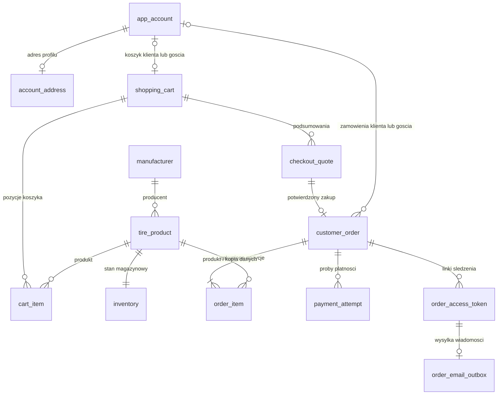

# TireShop — internetowy sklep z oponami

Aplikacja webowa umożliwiająca zakup opon jako gość lub zalogowany klient. Angular komunikuje się z REST API w Spring Boot, a dane są trwale przechowywane w PostgreSQL. Backend odpowiada za ceny, dostępność towaru, uprawnienia i przebieg zamówienia. Płatności są symulowane — aplikacja nie pobiera pieniędzy.

- **Demo wideo:** [obejrzyj prezentację aplikacji](https://drive.google.com/file/d/1aoMC0auILEpSjf3w70g6x4LHd34_TXc7/view).
- **Repozytorium i historia zmian:** [stanislaw-kopec/TireShop](https://github.com/stanislaw-kopec/TireShop).

## Technologie

- **Backend:** Java 25, Spring Boot 4.1.1, Spring Security i JWT, Spring Data JPA/Hibernate oraz JDBC.
- **Frontend:** Angular 21, TypeScript, Router, HttpClient i Signals.
- **Baza danych:** PostgreSQL 17 jako osobna usługa, migracje Flyway.
- **API:** REST, Jakarta Bean Validation, globalna obsługa błędów przez ProblemDetail, Swagger/OpenAPI.
- **Uruchomienie i testy:** Docker Compose, Nginx, Mailpit, JUnit, Mockito, Testcontainers, Vitest, GitHub Actions.

## Uruchomienie

Wymagany jest działający Docker z kontenerami Linux i Docker Compose 2.20 lub nowszym oraz wolne porty 4200, 8081 i 8026. Pierwsze budowanie wymaga internetu. Nie trzeba lokalnie instalować Javy, Mavena ani Node.js.

```sh
git clone https://github.com/stanislaw-kopec/TireShop.git
cd TireShop
docker compose up
```

Compose buduje aplikację i uruchamia cztery kontenery: frontend, backend, PostgreSQL oraz Mailpit. Migracje i dane demo przygotowują się automatycznie. Poczekaj na zakończenie uruchamiania backendu.

| Element | Adres |
|---|---|
| Sklep i panele użytkowników | [localhost:4200](http://localhost:4200) |
| Swagger UI | [localhost:8081/swagger-ui/index.html](http://localhost:8081/swagger-ui/index.html) |
| Mailpit — podgląd e-maili | [localhost:8026](http://localhost:8026) |

### Konta demo

| Konto | E-mail |
|---|---|
| Klient z adresem i koszykiem | customer@demo.test |
| Klient z rozbudowaną historią zamówień i płatności | history@demo.test |
| Pracownik | employee@demo.test |
| Administrator | admin@demo.test |

Wspólne początkowe hasło kont jest generowane przy pierwszym uruchomieniu i zapisane w **.demo/password.txt**. Można też zarejestrować klienta lub kupić jako gość. Świeże demo zawiera 24 produkty i 30 zamówień, w tym przykłady różnych statusów, prób płatności, zmian magazynowych i audytu.

**Ctrl+C** zatrzymuje uruchomione demo. Dane pozostają w wolumenie; restart nie resetuje kont ani zamówień. Zachowaj katalog **.demo** z hasłem i sekretami. Po zmianach kodu użyj polecenia **docker compose up --build**. Szczegóły: [dane demo](docs/demo.md) i [uruchomienie z IntelliJ/Mavena](docs/development.md).

## Funkcjonalności

| Użytkownik | Dostępne funkcje |
|---|---|
| Gość | Katalog, szczegóły i filtry opon, sortowanie, paginacja, koszyk z dodawaniem/edycją/usuwaniem pozycji, zakup bez konta, płatność i śledzenie przez link. |
| Klient | Rejestracja i logowanie, scalanie koszyka gościa po zalogowaniu, edycja danych i adresu, historia zamówień i płatności, status i numer przesyłki. |
| Pracownik | Tworzenie i edycja opon, przyjmowanie dostaw, korekty i historia magazynu, realizacja zamówień oraz przypisywanie i poprawianie numeru przesyłki. |
| Administrator | Ustalanie cen, dopuszczanie i wycofywanie produktów ze sprzedaży, tworzenie kont pracowników, inicjowanie resetu haseł i dziennik zdarzeń z filtrami. |

Administrator nie dziedziczy uprawnień pracownika. Usuwanie dotyczy pozycji koszyka; produkty wycofuje się ze sprzedaży, a historia zamówień pozostaje zachowana.

### Zakup i reguły biznesowe

Katalog → koszyk → zakup jako gość lub klient → adres i podsumowanie → symulator płatności → realizacja i śledzenie.

- Ceny są brutto w PLN. Dostawa kosztuje **20 zł dla 1–3 sztuk**, a **od 4 sztuk jest darmowa**, niezależnie od modelu i producenta.
- Koszyk nie rezerwuje towaru. Kliknięcie „Zapłać” tworzy zamówienie i **rezerwację na 15 minut**. Transakcje i blokady w PostgreSQL chronią przed sprzedażą ponad stan.
- Płatność można zatwierdzić, odrzucić lub anulować. Ponowienie nie przedłuża rezerwacji ani nie powoduje ponownego wydania towaru. Wygaśnięcie lub anulowanie nieopłaconego zamówienia zwalnia rezerwację.
- Zamówienie zachowuje kopię produktów, cen i adresu. Zmiany katalogu lub profilu nie zmieniają historii zakupów.
- Realizacja przebiega kolejno: **PENDING_PAYMENT → PAID → PROCESSING → SHIPPED → DELIVERED**. Wysłanie wymaga numeru przesyłki; nieopłacone zamówienie może przejść do CANCELLED.

## Architektura i bezpieczeństwo

Backend jest modularnym monolitem podzielonym na domeny: konta, katalog, koszyk, magazyn, zamówienia, płatności i audyt. DTO są głównie rekordami Javy. Przepływ żądania: **Angular → Spring Security → kontroler i walidacja DTO → serwis z regułami biznesowymi → repozytorium → PostgreSQL**. Błędy API mają wspólny format i są obsługiwane przez frontend.

Logowanie wydaje JWT Bearer ważny 15 minut. Angular przechowuje go w pamięci; odświeżenie strony wymaga ponownego logowania. Backend sprawdza rolę oraz właściciela zasobu. Koszyk gościa, zakup i link śledzenia mają oddzielne tokeny dostępu.

**Mechanizmy rozszerzone:** zdarzenia Springa zasilają audyt zamówień, scheduler zwalnia wygasłe rezerwacje i obsługuje kolejkę e-maili w PostgreSQL. Wiadomości po zapłacie są wysyłane w tle z ponawianiem; awaria poczty nie cofa płatności. Lokalnie Mailpit przechwytuje wiadomości SMTP i pozwala otworzyć link śledzenia, zaproszenia lub resetu hasła bez rzeczywistej skrzynki odbiorcy.

## Model danych — ERD

Poniżej główne relacje modelu biznesowego. **[Pełny ERD wszystkich 19 tabel, z kluczami i opisem relacji](docs/erd.md)** odpowiada migracjom V1–V11.



Konto może nie mieć adresu ani koszyka; koszyk i zamówienie gościa nie mają przypisanego konta. Tabele cart_item i order_item łączą produkty odpowiednio z koszykiem i zamówieniem. Jedno zamówienie może mieć wiele prób płatności, ale najwyżej jedną udaną.

## Dokumentacja REST API

Po uruchomieniu dostępne są [Swagger UI](http://localhost:8081/swagger-ui/index.html) i [specyfikacja OpenAPI](http://localhost:8081/v3/api-docs). Aby wykonać chronione żądanie, zaloguj się przez **POST /api/auth/login**, a otrzymany **accessToken** podaj w **Authorize**. API działa pod **/api** i zwraca JSON.

Kontrakty: [konta](docs/backend-api.md), [katalog i magazyn](docs/catalog-api.md), [koszyk](docs/cart-api.md), [zamówienia](docs/order-api.md), [płatności](docs/payment-api.md), [śledzenie](docs/tracking-api.md), [realizacja](docs/fulfillment-api.md), [audyt](docs/audit-api.md).

## Testy i ciągła integracja

Testy jednostkowe sprawdzają reguły biznesowe, a integracyjne REST API, uprawnienia, migracje, płatności i współbieżne operacje na rzeczywistym PostgreSQL przez Testcontainers. Frontend ma testy Vitest. [GitHub Actions](.github/workflows/ci.yml) uruchamia testy i buduje aplikacje oraz obrazy Docker.

Backend — z katalogu **backend**, przy działającym Dockerze:

```powershell
.\mvnw.cmd clean verify
```

Na Linux/macOS użyj **sh ./mvnw clean verify**. Frontend — z katalogu **frontend**:

```sh
npm ci
npm test -- --watch=false
npm run build
```
