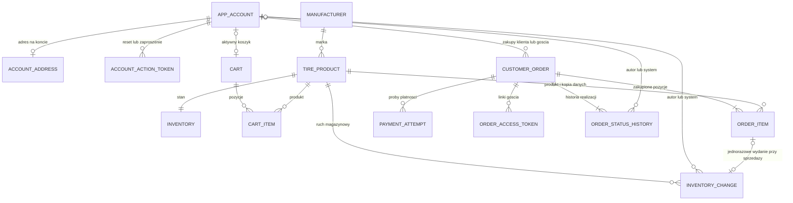

# TireShop — wstępny projekt backendu i bazy

Stan: projekt do omówienia, 9 października 2026. Wymagania wiążące są w `AGENTS.md`. Ten dokument nie jest migracją ani deklaracją zaimplementowanych funkcji. Obejmuje backend; Angular jest przyszłym klientem API.

Pierwszy etap został zaimplementowany: Flyway tworzy `app_account`, `account_address`, `account_action_token` oraz dwie tabele Spring Session JDBC. Działają rejestracja, logowanie, CSRF, profil i adres, wyszukiwanie kont po e-mailu przez administratora, zaproszenia pracowników, reset haseł i opcjonalne utworzenie pierwszego administratora. Kontrakt znajduje się w [backend-api.md](backend-api.md). Pozostałe tabele i procesy poniżej przedstawiają dalszy projekt, a nie aktualny schemat bazy.

## Przyjęte decyzje

- PostgreSQL, jeden backend Spring Boot, pakiety domenowe, Java 25 i DTO jako rekordy.
- Uwierzytelnianie przez sesję w cookie, bez JWT. Sesja i uprawnienia powstają wcześnie, przed prywatnymi operacjami koszyka i zamówień.
- Produkt to marka + model + szerokość + profil + średnica + sezon. Indeksy nośności/prędkości, XL i run-flat pozostają poza MVP.
- Pracownik tworzy produkty, edytuje parametry i zdjęcia oraz zarządza magazynem. Administrator ustala ceny brutto w PLN i jako jedyny włącza/wyłącza produkty w sprzedaży. Nowy produkt domyślnie nie jest w sprzedaży. Brak ceny oznacza brak możliwości zakupu.
- Przyjęcia, korekty i wydania towaru zapisujemy w prostym rejestrze `inventory_change`, z autorem, datą, zmianą ilości i powodem, w tej samej transakcji co aktualizację magazynu.
- Koszyk gościa łączy się po zalogowaniu z koszykiem klienta: ilości tych samych produktów są sumowane i następuje sprawdzenie dostępności.
- Rezerwacja przy złożeniu zamówienia trwa 15 minut. Próby płatności nie przedłużają terminu.
- Dostawa za 1–3 sztuki: 20 zł brutto; od 4 sztuk: 0 zł. Liczy się suma sztuk wszystkich produktów.
- Gość po zapłacie otrzymuje link do statusu na ekranie oraz e-mailem, ważny 90 dni od zapłaty. Może otrzymać nowy link na e-mail zapisany w zamówieniu; odnowiony link jest ważny 90 dni od wydania.

## Ścieżka zakupu i odpowiedzialność backendu

Katalog z filtrami → koszyk → wybór zakupu gościnnego lub konta → adres i dostawa → podsumowanie → „Zapłać” → symulator płatności → potwierdzenie i śledzenie.

- Główna lista zawiera produkty `on_sale = true`, z dodatnią ceną i dostępnością `on_hand - reserved > 0`. Lista nie stanowi gwarancji dostępności przy zakupie.
- Zalogowany klient nie musi ponownie wybierać logowania. Dla klienta z adresem formularz korzysta z zapisanych danych; gość i klient bez adresu muszą podać dane kontaktowe i adres. Podsumowanie zawsze pokazuje adres, dostawę i pełną kwotę.
- Zamówienie powstaje dopiero przy „Zapłać”, a nie przy wejściu do koszyka czy adresu. Backend weryfikuje zakup, zapisuje snapshoty i rezerwuje sztuki na 15 minut przed przejściem do symulatora. Tworzenie pierwszej próby płatności musi być bezpiecznie ponawialne dla tego zamówienia.
- Logowanie przed zakupem scala koszyki i wymaga odświeżenia podsumowania. Po utworzeniu zamówienia jego właściciel, pozycje, adres i kwota nie zmieniają się wskutek późniejszego logowania lub edycji koszyka.
- Sukces dla gościa: link do statusu na ekranie i e-mailem. Sukces dla konta: numer zamówienia i odnośnik do własnego zamówienia w panelu. Odpowiedzi backendu muszą umożliwiać te dwa warianty, bez budowania teraz Angulara.
- Panel konta obejmuje edycję adresu oraz odczyt własnych zamówień, ich statusów i numerów przesyłek.

## Diagram relacji

Poniższy diagram pokazuje tabele domenowe. Pola złożone, szczegółowe indeksy oraz techniczne tabele Spring Session opisano dalej. `o|` oznacza zero lub jeden, `o{` zero lub wiele, a `|{` jeden lub wiele.

W projekcie jest 14 tabel domenowych, w tym zatwierdzony prosty rejestr zmian magazynu `INVENTORY_CHANGE`. Nie dodajemy tabel słownikowych dla każdej wartości enum ani osobnych tabel modelu, rozmiaru i sezonu.

## Tabele i kluczowe pola

Typy wspólne: identyfikatory `uuid`, kwoty `numeric(12,2)`, czas `timestamptz` (Java `Instant`), ilości `integer`. Statusy i role jako `varchar` z ograniczeniami `CHECK`, mapowane na enumy. Przyjęte nazwy są robocze. Pole `version` służy kontroli konfliktów edycji, a nie wersjonowaniu schematu.

| Tabela / domena | Kluczowe pola | Zasady |
|---|---|---|
| `app_account` / account | `id PK`, `email`, `password_hash`, `role`, `status`, `first_name`, `last_name`, `phone`, `created_at`, `updated_at`, `version` | E-mail normalizowany i unikalny bez rozróżniania wielkości liter. Role: CUSTOMER, EMPLOYEE, ADMIN. Propozycja: jedna rola na konto. Status: INVITED, ACTIVE, DISABLED. Hasło może być NULL tylko przed przyjęciem zaproszenia. |
| `account_address` / account | `account_id PK/FK`, `recipient_name`, `street`, `building_number`, `apartment_number NULL`, `postal_code`, `city`, `country_code`, `version` | Zero lub jeden adres. Rejestracja bez adresu jest możliwa; adres jest wymagany przy zakupie. |
| `account_action_token` / account | `id PK`, `account_id FK`, `purpose`, `token_hash UNIQUE`, `created_at`, `expires_at`, `used_at NULL`, `revoked_at NULL` | Reset hasła i ustawienie pierwszego hasła pracownika. Token jednorazowy, związany z celem. Brak jawnego tokenu w tej tabeli. |
| `manufacturer` / catalog | `id PK`, `name`, `normalized_name UNIQUE` | Jedna marka, np. Dębica. Normalizacja zapobiega duplikatom różniącym się spacjami lub wielkością liter. |
| `tire_product` / catalog | `id PK`, `manufacturer_id FK`, `model`, `normalized_model`, `width_mm`, `aspect_ratio`, `rim_diameter_in`, `season`, `image_ref NULL`, `price_gross NULL`, `on_sale DEFAULT false`, `created_at`, `updated_at`, `version` | Jeden wariant produktu. Unikalna kombinacja marki, znormalizowanego modelu, rozmiaru i sezonu. Cena dodatnia albo NULL; NULL nie oznacza zera. `on_sale` zmienia tylko admin; włączenie sprzedaży wymaga ustalonej ceny. `image_ref` to adres/referencja do pliku, nie obraz w bazie. |
| `inventory` / inventory | `product_id PK/FK`, `on_hand`, `reserved`, `version`, `updated_at` | `0 <= reserved <= on_hand`. Dostępne = `on_hand - reserved`; nie zapisujemy trzeciego niezależnego licznika. Produkt i stan początkowy 0 tworzone atomowo. |
| `cart` / cart | `id PK`, `account_id FK NULL UNIQUE`, `guest_owner_key NULL UNIQUE`, `updated_at`, `version` | Dokładnie jeden właściciel: konto albo anonimowy kontekst. Jeden aktywny koszyk klienta. `guest_owner_key` trzymany w sesji po stronie serwera, nie jest publicznym tokenem API. |
| `cart_item` / cart | `id PK`, `cart_id FK`, `product_id FK`, `quantity` | UNIQUE(cart_id, product_id), quantity > 0. Cena odczytywana z katalogu; koszyk niczego nie rezerwuje. |
| `customer_order` / order | `id PK`, `order_number UNIQUE`, `account_id FK NULL`, `guest_owner_key NULL`, `status`, `contact_email`, `contact_phone`, pola adresu dostawy, `currency`, `items_total_gross`, `shipping_gross`, `total_gross`, `created_at`, `reservation_expires_at`, `paid_at NULL`, `tracking_number NULL`, `shipped_at NULL`, `delivered_at NULL`, `cancellation_reason NULL`, `checkout_key UNIQUE`, `checkout_request_hash`, `version` | Dokładnie jeden właściciel podczas zakupu: konto albo kontekst gościa. Zamówienie gościa nie tworzy fikcyjnego konta. Adres i kontakt są kopią z chwili zakupu. `checkout_key` chroni przed podwójnym kliknięciem zakupu; wynik dostępny tylko uprawnionemu właścicielowi. |
| `order_item` / order | `id PK`, `order_id FK`, `product_id FK`, `quantity`, `manufacturer_name`, `model`, `width_mm`, `aspect_ratio`, `rim_diameter_in`, `season`, `unit_price_gross`, `line_total_gross` | UNIQUE(order_id, product_id), quantity > 0. Dane opisowe i cena są niezmiennym snapshotem. FK nie zastępuje kopii. |
| `payment_attempt` / payment | `id PK`, `order_id FK`, `status`, `amount_gross`, `currency`, `created_at`, `finished_at NULL`, `failure_code NULL` | Jedno zamówienie może mieć wiele prób, ale najwyżej jedną oczekującą i jedną udaną. Kwota z zamówienia, nie z przeglądarki. ID próby nie daje prawa zmiany wyniku. |
| `order_access_token` / order | `id PK`, `order_id FK`, `token_hash UNIQUE`, `created_at`, `expires_at`, `revoked_at NULL` | Wielokrotny odczyt statusu gościa; to inny token niż jednorazowy reset hasła. Pierwszy link wygasa 90 dni po zapłacie; odnowiony link wygasa 90 dni od swojego wydania. Nowy link wysyłany wyłącznie na e-mail zamówienia. |
| `order_status_history` / order | `id PK`, `order_id FK`, `from_status NULL`, `to_status`, `changed_by FK NULL`, `changed_at`, `reason NULL` | Historia zmian; NULL autora oznacza system, np. płatność lub wygaśnięcie. Tworzona razem ze zmianą statusu. |
| `inventory_change` / inventory | `id PK`, `product_id FK`, `actor_account_id FK NULL`, `order_item_id FK NULL UNIQUE`, `quantity_delta`, `reason`, `created_at` | Przyjęcia, korekty i wydania po zapłacie. Dla wydania wymagane powiązanie z pozycją zamówienia; dla pozostałych zdarzeń NULL. NULL autora oznacza system. Rezerwacja nie zmienia stanu fizycznego i nie jest wydaniem. |

Adres w zamówieniu obejmuje te same pola co `account_address`; w JPA można użyć `@Embeddable`. Nie ma FK do bieżącego adresu konta. Dodatkowych nazwanych adresów i osobnej tabeli przesyłek nie potrzeba przy jednym adresie i jednej przesyłce na zamówienie.

Rejestr magazynu jest dopisywany w tej samej transakcji co zmiana `on_hand`; wcześniejszych wpisów nie edytujemy ani nie usuwamy operacjami aplikacji. Błąd poprawia nowy wpis korekty. Nie tworzymy ogólnego systemu audytu. Indeks `(product_id, created_at)` pozwala odczytać historię danego produktu.

## Dlaczego rezerwacja jest przy zamówieniu

Każde zamówienie powstaje od razu z jedną rezerwacją wszystkich jego niezmiennych pozycji. Wystarczą `reservation_expires_at`, stan zamówienia oraz ilości z `order_item` — osobne tabele rezerwacji i ich pozycji powielałyby te informacje.

- Złożenie zamówienia: w jednej transakcji odczytaj/zablokuj produkty i ich magazyn, sprawdź aktywność oraz cenę, potwierdź dostępność wszystkich pozycji, zwiększ `reserved`, zapisz zamówienie i jego kopie danych. Całość albo nic.
- Zapłata przed terminem: zablokuj zamówienie; zweryfikuj próbę, status i czas; pomniejsz zarówno `on_hand`, jak i `reserved`, ustaw PAID oraz zakończ próbę. Zapisz historię statusu oraz wydania w `inventory_change` w tej samej transakcji.
- Wygaśnięcie/anulowanie nieopłaconego zamówienia: zablokuj zamówienie, pomniejsz `reserved`, ustaw CANCELLED. Nie zmniejszaj `on_hand`. Oczekującą próbę zakończ jako CANCELLED z powodem EXPIRED lub ORDER_CANCELLED.
- Odrzucenie/anulowanie samej próby: zmiana próby, bez zwalniania rezerwacji. Zamówienie dalej oczekuje do pierwotnego terminu.
- Ponowiony komunikat o już udanej płatności zwraca ten sam rezultat i nie zmienia magazynu, również jeśli dotrze później niż termin rezerwacji. Nowy sukces przy nieopłaconym zamówieniu jest dozwolony tylko dla `now < reservation_expires_at`.
- Zadanie okresowe wyszukuje wygasłe PENDING_PAYMENT. Po restarcie działa na terminach w bazie; nie opiera się wyłącznie na timerze w pamięci. Krótkie opóźnienie zwolnienia może zaniżyć dostępność, ale nie może dopuścić spóźnionej płatności.

Płatność i zwolnienie stosują tę samą kolejność blokad: zamówienie, potem rekordy magazynowe w rosnącej kolejności ID produktu. Wszystkie operacje obejmujące wiele produktów stosują tę samą kolejność. Edycja ceny i zakup muszą używać wspólnej kontroli współbieżności produktu. `@Version` samo w sobie nie zastępuje przemyślanej transakcji i obsługi konfliktu.

To projekt algorytmu, nie obietnica poprawności bez testów: potrzebny test na PostgreSQL, w którym dwóch kupujących rywalizuje o ostatnie sztuki, oraz test równoczesnego sukcesu płatności i wygaśnięcia.

## Ograniczenia i indeksy

- FK do produktów i kont nie mogą kaskadowo usuwać zamówień. Produkty wycofuj logicznie (`on_sale = false`), konta wyłączaj. Usuwanie/anonymizacja danych to osobna decyzja.
- Unikalny, znormalizowany e-mail; unikalny wariant produktu; UNIQUE(cart_id, product_id) i UNIQUE(order_id, product_id).
- CHECK dla dodatnich ilości i cen, nieujemnych kwot, `reserved <= on_hand`, currency = PLN oraz właściciela koszyka/zamówienia (konto XOR gość).
- CHECK `total_gross = items_total_gross + shipping_gross` i `line_total_gross = quantity * unit_price_gross`. Suma pozycji i reguła dostawy obejmują wiele wierszy, więc muszą być utrzymywane w transakcji, nie zwykłym CHECK między tabelami.
- Unikalne indeksy częściowe na payment_attempt(order_id) dla statusu PENDING oraz osobno SUCCEEDED. Przejścia płatności nadal wymagają blokady zamówienia i walidacji w serwisie.
- customer_order(account_id, created_at), order_status_history(order_id, changed_at), payment_attempt(order_id, created_at); indeksy FK pozycji.
- Indeks na reservation_expires_at tylko dla PENDING_PAYMENT; indeksy terminów tokenów dla porządkowania danych.
- Katalog: indeks po rozmiarze, osobno po marce; indeksy sortowania dobierz do rzeczywistych zapytań. Nie twórz wszystkich kombinacji filtrów na zapas.
- CHECK nie wymusi automatycznie co najmniej jednej pozycji ani zgodności `reserved` z oczekującymi zamówieniami. Egzekwuj je przez transakcje, testy i ograniczenie zapisów do operacji domenowych.

## Uwierzytelnianie: sesja z cookie

Wybrano sesję. Dla jednego backendu obsługującego własną aplikację Angular jest to prostszy punkt startu niż utrzymywanie access tokenów, refresh tokenów, rotacji i unieważniania JWT. REST nie wymaga JWT. To ocena dopasowania do tego projektu, a nie uniwersalna przewaga sesji.

| Wariant | Konsekwencja dla projektu |
|---|---|
| Sesja w cookie — wybrana | Losowy identyfikator w przeglądarce, stan logowania po stronie backendu; naturalna obsługa wylogowania i unieważniania sesji. |
| JWT | Potrzebny projekt czasu życia, odświeżania, kradzieży i unieważniania tokenów; sensowniejszy przy konkretnych wymaganiach zewnętrznych klientów lub integracji z dostawcą tożsamości. |

Konfiguracja bezpieczeństwa:

- Spring Security; hasła przez `PasswordEncoder`, bez własnej kryptografii. Uwierzytelnianie, CSRF, role i kontrola właściciela także w testach API.
- Cookie sesji `HttpOnly`, `Secure` na HTTPS, `SameSite=Lax`; ochrona przed session fixation przy logowaniu. Nie przechowuj identyfikatora sesji w localStorage. Cookie HttpOnly ogranicza możliwość jego odczytu przez JavaScript, ale nie usuwa całego ryzyka XSS. [OWASP: zarządzanie sesją](https://cheatsheetseries.owasp.org/cheatsheets/Session_Management_Cheat_Sheet.html).
- Angular i API docelowo pod tym samym originem, API pod `/api`; lokalnie przyszły frontend może używać proxy. Jeżeli originy będą różne, jawna lista dozwolonych originów i obsługa credentials; nie `*`. To założenie wdrożeniowe do potwierdzenia.
- Pozostaw ochronę CSRF. Spring wspiera konwencję `XSRF-TOKEN` / `X-XSRF-TOKEN`. Cookie tokenu CSRF odczytywane przez Angular to osobne cookie od HttpOnly cookie sesji. Po logowaniu/wylogowaniu potrzebne jest pobranie aktualnego tokenu. [Spring Security: SPA i CSRF](https://docs.spring.io/spring-security/reference/servlet/exploits/csrf.html).
- Angular wspiera wysyłanie tokenu XSRF dla odpowiednich żądań; backend musi go sprawdzać. Szczegóły originów trzeba dopasować przed integracją, nie wyłączać CSRF dla wygody. [Angular: bezpieczeństwo HTTP](https://angular.dev/best-practices/security).
- Zaimplementowano Spring Session JDBC na tej samej bazie, by restart backendu nie kończył wszystkich sesji. Techniczne tabele `SPRING_SESSION` i `SPRING_SESSION_ATTRIBUTES` pochodzą ze schematu biblioteki; nie tworzymy własnych encji JPA sesji ani własnego magazynu sesji. [Spring Session JDBC](https://docs.spring.io/spring-session/reference/configuration/jdbc.html).
- Pierwszy etap używa 30 minut bezczynności i maksymalnie 8 godzin od logowania, bez „zapamiętaj mnie”. Parametry są konfigurowalne. `auth_version` konta wzrasta po ustawieniu nowego hasła; porównanie z wersją zapisaną w sesji odbiera dostęp wszystkim wcześniejszym sesjom. Wyłączenie konta również odbiera dostęp przy następnym żądaniu.
- Opcjonalny bootstrap tworzy pierwszego administratora z danych środowiskowych, bez hasła domyślnego i bez zmiany istniejących kont. Zaproszenia są ważne 24 godziny, linki resetu 30 minut. Lokalnie wiadomości trafiają do Mailpit. Wysyłka w tym etapie jest synchroniczna; błąd SMTP wycofuje wydanie tokenu. Kolejka poczty dla płatności pozostaje osobną propozycją.

Minimalny kontrakt: pobranie CSRF, rejestracja, logowanie, wylogowanie, `GET /api/account/me`, zmiana własnego adresu oraz rozpoczęcie/zakończenie resetu. JSON i statusy 401/403 zamiast przekierowania na HTML logowania. JWT i tabela refresh tokenów nie są potrzebne w wybranym wariancie.

## Koszyk, zakup gościa i link do śledzenia to różne uprawnienia

1. Gość ma anonimowy kontekst w sesji. Backend wiąże z nim koszyk i jego zamówienia oczekujące na zapłatę. Przeglądarka nie wybiera sobie właściciela przez parametr `accountId` czy `guestOwnerKey`.
2. Przy logowaniu rotacja sesji zachowuje dozwolony kontekst gościa. Połączenie koszyków jest atomowe, sumuje ilości i usuwa/scaleniowo zamyka źródło dokładnie raz. Równoczesne żądania logowania nie mogą podwoić ilości.
3. Gdy suma przewyższa stan, propozycja zachowania UX: zachowaj żądaną ilość i zwróć konflikt dostępności dla pozycji; nie usuwaj ani nie zmniejszaj sztuk po cichu. Zakup pozostaje zablokowany do poprawienia koszyka. Sam merge nie rezerwuje towaru.
4. Przed zapłatą gość może rozpocząć/ponowić płatność tylko dla zamówienia własnego kontekstu. Endpoint symulatora również sprawdza to uprawnienie — znajomość ID próby nie wystarczy.
5. Po zapłacie osobny token śledzenia daje tylko odczyt statusu i numeru przesyłki. Nie loguje na konto, nie pozwala płacić, anulować, edytować adresu ani oglądać wszystkich danych zamówienia.
6. Baza przechowuje skrót losowego tokenu śledzenia. Jawny token trafia do uprawnionego odbiorcy; filtrujemy go z logów i nie umieszczamy danych osobowych w samym tokenie.
7. Nie przypisuj historycznego zamówienia gościa do nowego konta tylko dlatego, że e-maile są identyczne. To wymaga osobnej, zweryfikowanej operacji, której nie ma w MVP.
8. Link początkowy wygasa 90 dni od zapłaty. Nowy link można wysłać tylko na zapisany e-mail zamówienia i ma on 90 dni ważności od wydania. Publiczne żądanie ponownej wysyłki nie zwraca tokenu ani nie ujawnia istnienia zamówienia; wymaga ograniczenia częstotliwości. Samo anonimowe żądanie nie powinno unieważniać jeszcze działającego linku, aby osoba postronna nie mogła odbierać dostępu odbiorcy.

Koszyk jest zapisany w bazie, ale dostęp gościa zależy od życia anonimowej sesji. Dłuższe zachowanie anonimowego koszyka wymaga osobnej decyzji o cookie i retencji. Utrata sesji przed zapłatą oznacza w tym projekcie brak dostępu do oczekującego zamówienia i jego wygaśnięcie po 15 minutach; już otrzymany link po zapłacie działa niezależnie od sesji.

## Rzeczy przydatne, lecz jeszcze do zatwierdzenia

| Temat | Propozycja | Powód |
|---|---|---|
| Zmiana ceny w koszyku | Ponowne potwierdzenie kwoty przed złożeniem zamówienia | Klient nie powinien nieświadomie kupić drożej. Cena złożonego zamówienia jest zamrożona na czas płatności. |
| Adres przy zakupie | Osobna decyzja klienta o zapisaniu wpisanego adresu na koncie | Adres jednorazowej dostawy nie powinien automatycznie nadpisywać profilu. |
| Numer przesyłki | Wymagany do przejścia do SHIPPED, jedna przesyłka na zamówienie | Unika statusu „wysłane” bez danych do śledzenia. |
| Anulowanie | Klient anuluje tylko nieopłacone zamówienie; proces zwrotów poza MVP | Zgodne z brakiem symulatora zwrotów. Link śledzenia nie daje prawa anulowania. |
| Uprawnienia admina | Pozostawić osobne od pracownika; ewentualne łączenie ról ustalić wcześniej | Wpływa na pole role i testy autoryzacji. |
| E-mail i awarie | Mała kolejka wiadomości w tej samej bazie (`email_outbox`) z ponawianiem | Awaria poczty nie cofa zapłaty. Nie potrzeba brokera. Tabela opcjonalna, poza głównym ERD. |

Jeśli akceptujemy outbox: zapis zadania wiadomości razem z zatwierdzeniem zamówienia, wysyłka po commit, ograniczone retry i status błędu. Wiadomość może zawierać jawny token linku, którego nie da się odzyskać ze skrótu; taki payload wymaga ochrony (np. szyfrowania) i usunięcia po wysyłce. Identyfikator zdarzenia zapobiega tworzeniu wielu zadań dla powtórnej płatności. Nie obiecujemy „dokładnie jednej wysyłki” przez SMTP.

## Kolejność implementacji i granice projektu

1. Migracje Flyway, globalne błędy, szkic API i testy PostgreSQL. Nie generować całego schematu bez uzgodnienia otwartych decyzji. Fundament oraz migracje kont i sesji są zaimplementowane.
2. Konta, logowanie sesyjne, CSRF, role, właściciel zasobu, zaproszenia/reset. Frontend nie jest potrzebny do testów tego etapu.
3. Katalog i magazyn wraz z uprawnieniami pracownika/admina; publiczny odczyt katalogu może powstawać równolegle koncepcyjnie.
4. Koszyk gościa/klienta i bezpieczne łączenie po zalogowaniu.
5. Zamówienia, snapshoty, dostawa, atomowa rezerwacja i wygaśnięcie; idempotencja checkoutu. Ten sam klucz z inną treścią żądania zwraca konflikt, nie nowe zamówienie.
6. Symulator płatności, linki gościa i wiadomości. Testy wyścigów oraz duplikatów.
7. Realizacja zamówień przez pracownika, historia statusów, numer przesyłki i uzupełnienie testów uprawnień.

Nie odkładamy bezpieczeństwa na koniec: późniejsza zmiana właściciela koszyka, sposobu identyfikacji gościa i dostępu do zamówienia wymuszałaby przebudowę tych funkcji. Nie implementujemy teraz Angulara, realnych płatności, zwrotów, podatkowego modułu faktur, wielu magazynów ani integracji kuriera.

## Przegląd spójności projektu

- Każda funkcja z AGENTS ma reprezentację w modelu; koszt dostawy nie potrzebuje osobnej tabeli dla jednej reguły.
- Snapshot adresu i pozycji chroni historię. Produkt bez ceny nie jest kupowalny; wycofanie produktu nie usuwa zamówień.
- Role zabezpieczają operacje, a właściciel zabezpiecza konkretny koszyk i zamówienie. Gość nie jest rolą konta.
- Jeden termin rezerwacji obejmuje wszystkie próby. Duplikat udanego wyniku i nowy spóźniony sukces to różne przypadki.
- Konta i sesje są sprawdzane testami HTTP na osobnym PostgreSQL przez Testcontainers. Migracje i transakcje przyszłych domen sklepu będą wymagały własnej weryfikacji.
