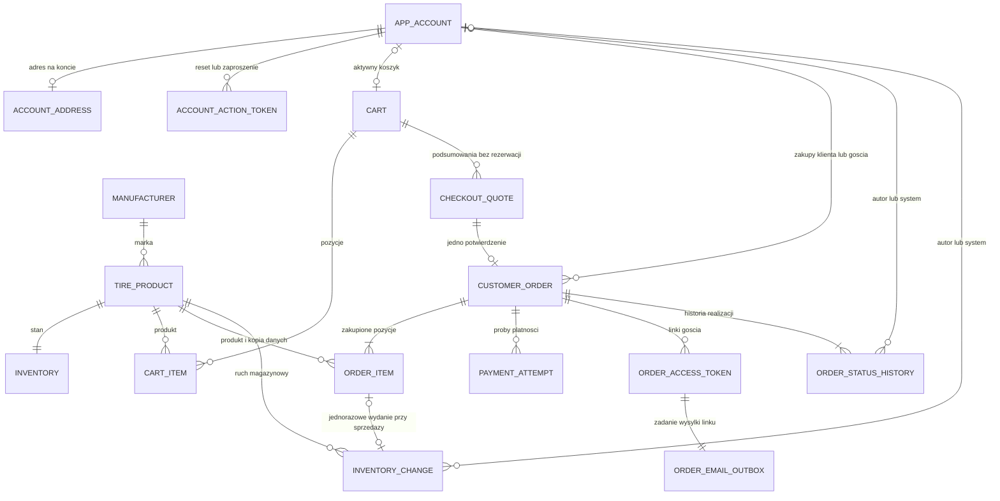

# TireShop — wstępny projekt backendu i bazy

Stan: projekt z 9 października, aktualizacja po wdrożeniu śledzenia gościa i kolejki poczty 5 listopada 2026. Wymagania wiążące są w `AGENTS.md`. Dokument odróżnia bieżącą implementację od dalszego projektu. Obejmuje backend; Angular jest przyszłym klientem API.

Pierwszy etap obejmuje `app_account`, `account_address`, `account_action_token`, rejestrację, JWT Bearer, profil i adres, wyszukiwanie kont przez administratora, zaproszenia i reset haseł. JWT zastąpił sesje HTTP: historyczne V1/V2 pozostają, a V3 usuwa tabele Spring Session. Kontrakt: [backend-api.md](backend-api.md).

Drugi etap (V4) dodaje `manufacturer`, `tire_product`, `inventory` i `inventory_change`: katalog publiczny i personelu, parametry produktu, ceny, dopuszczenie sprzedaży, dostawy, korekty oraz historię magazynu. Kontrakt: [catalog-api.md](catalog-api.md). V5 dodaje `shopping_cart` i `cart_item`: [cart-api.md](cart-api.md). V6 dodaje `checkout_quote`, `customer_order`, `order_item` i rezerwację 15 minut: [order-api.md](order-api.md). V7 dodaje `payment_attempt`, paid_at i wpisy SALE: [payment-api.md](payment-api.md). V8 dodaje `order_access_token`, `order_email_outbox`, `tracking_request_limit` i tracking_number: [tracking-api.md](tracking-api.md). Bieżący schemat ma 14 tabel domenowych oraz 2 techniczne tabele kolejki i limitów. Historia realizacji w diagramie pozostaje dalszym projektem. Symbol CART odpowiada `shopping_cart`.

## Przyjęte decyzje

- PostgreSQL, jeden backend Spring Boot, pakiety domenowe, Java 25 i DTO jako rekordy.
- Uwierzytelnianie kont przez JWT Bearer, 15 minut ważności, bez refresh tokenów. To zastępuje wcześniejszą decyzję o sesji. Role i kontrola właściciela nadal poprzedzają prywatne operacje koszyka i zamówień.
- Produkt to marka + model + szerokość + profil + średnica + sezon. Indeksy nośności/prędkości, XL i run-flat pozostają poza MVP.
- Pracownik tworzy produkty, edytuje parametry i zdjęcia oraz zarządza magazynem. Administrator ustala ceny brutto w PLN i jako jedyny włącza/wyłącza produkty w sprzedaży. Nowy produkt domyślnie nie jest w sprzedaży. Brak ceny oznacza brak możliwości zakupu.
- Przyjęcia, korekty i wydania towaru zapisujemy w prostym rejestrze `inventory_change`, z autorem, datą, zmianą ilości i powodem, w tej samej transakcji co aktualizację magazynu.
- Koszyk gościa łączy się po zalogowaniu z koszykiem klienta: ilości tych samych produktów są sumowane i następuje sprawdzenie dostępności.
- Rezerwacja przy złożeniu zamówienia trwa 15 minut. Próby płatności nie przedłużają terminu.
- Dostawa za 1–3 sztuki: 20 zł brutto; od 4 sztuk: 0 zł. Liczy się suma sztuk wszystkich produktów.
- Gość po zapłacie otrzymuje link do statusu na ekranie oraz e-mailem, ważny 90 dni od zapłaty. Może otrzymać nowy link na e-mail zapisany w zamówieniu; odnowiony link jest ważny 90 dni od wydania.

## Ścieżka zakupu i odpowiedzialność backendu

Katalog z filtrami → koszyk → wybór zakupu gościnnego lub konta → adres i dostawa → podsumowanie → „Zapłać” → symulator płatności → potwierdzenie i śledzenie.

- Główna lista zawiera produkty `on_sale = true`, z dodatnią ceną i dostępnością `on_hand - reserved > 0`. Lista nie stanowi gwarancji dostępności przy zakupie.
- Zalogowany klient nie musi ponownie wybierać logowania. Dla klienta z adresem formularz korzysta z zapisanych danych; gość i klient bez adresu muszą podać dane kontaktowe i adres. Podsumowanie zawsze pokazuje adres, dostawę i pełną kwotę.
- Zamówienie powstaje dopiero przy „Zapłać”, a nie przy wejściu do koszyka czy adresu. Backend weryfikuje zakup, zapisuje snapshoty i rezerwuje sztuki na 15 minut przed przejściem do symulatora. Tworzenie pierwszej próby płatności musi być bezpiecznie ponawialne dla tego zamówienia.
- Logowanie przed zakupem scala koszyki i wymaga odświeżenia podsumowania. Po utworzeniu zamówienia jego właściciel, pozycje, adres i kwota nie zmieniają się wskutek późniejszego logowania lub edycji koszyka.
- Sukces dla gościa: link do statusu na ekranie i e-mailem. Sukces dla konta: numer zamówienia i odnośnik do własnego zamówienia w panelu. Odpowiedzi backendu muszą umożliwiać te dwa warianty, bez budowania teraz Angulara.
- Panel konta obejmuje edycję adresu oraz odczyt własnych zamówień, ich statusów i numerów przesyłek.

## Diagram relacji

Poniższy diagram pokazuje docelowe tabele domenowe. Pola złożone i szczegółowe indeksy opisano dalej. Historyczne tabele Spring Session są usuwane przez V3 i nie należą do bieżącego modelu. `o|` oznacza zero lub jeden, `o{` zero lub wiele, a `|{` jeden lub wiele.

Docelowy projekt obejmuje 15 tabel domenowych, z których 14 jest wdrożonych. V8 dodaje również techniczną kolejkę ORDER_EMAIL_OUTBOX i niezależną tabelę limitów TRACKING_REQUEST_LIMIT (bez FK do zamówień — także dla nieistniejących numerów). Nie dodajemy tabel słownikowych dla każdej wartości enum ani osobnych tabel modelu, rozmiaru i sezonu.

## Tabele i kluczowe pola

Typy wspólne: identyfikatory `uuid`, kwoty `numeric(12,2)`, czas `timestamptz` (Java `Instant`), ilości `integer`. Statusy i role jako `varchar` z ograniczeniami `CHECK`, mapowane na enumy. Przyjęte nazwy są robocze. Pole `version` służy kontroli konfliktów edycji, a nie wersjonowaniu schematu.

| Tabela / domena | Kluczowe pola | Zasady |
|---|---|---|
| `app_account` / account | `id PK`, `email`, `password_hash`, `role`, `status`, `first_name`, `last_name`, `phone`, `created_at`, `updated_at`, `auth_version`, `version` | E-mail normalizowany i unikalny bez rozróżniania wielkości liter. Role: CUSTOMER, EMPLOYEE, ADMIN. Propozycja: jedna rola na konto. Status: INVITED, ACTIVE, DISABLED. Hasło może być NULL tylko przed przyjęciem zaproszenia. |
| `account_address` / account | `account_id PK/FK`, `recipient_name`, `street`, `building_number`, `apartment_number NULL`, `postal_code`, `city`, `country_code`, `version` | Zero lub jeden adres. Rejestracja bez adresu jest możliwa; adres jest wymagany przy zakupie. |
| `account_action_token` / account | `id PK`, `account_id FK`, `purpose`, `token_hash UNIQUE`, `created_at`, `expires_at`, `used_at NULL`, `revoked_at NULL` | Reset hasła i ustawienie pierwszego hasła pracownika. Token jednorazowy, związany z celem. Brak jawnego tokenu w tej tabeli. |
| `manufacturer` / catalog | `id PK`, `name`, `normalized_name UNIQUE` | Jedna marka, np. Dębica. Normalizacja zapobiega duplikatom różniącym się spacjami lub wielkością liter. |
| `tire_product` / catalog | `id PK`, `manufacturer_id FK`, `model`, `normalized_model`, `width_mm`, `aspect_ratio`, `rim_diameter_in`, `season`, `image_url NULL`, `price_gross NULL`, `on_sale DEFAULT false`, `created_at`, `updated_at`, `version` | Jeden wariant produktu. Unikalna kombinacja marki, znormalizowanego modelu, rozmiaru i sezonu. Cena dodatnia albo NULL; NULL nie oznacza zera. `on_sale` zmienia tylko admin; włączenie sprzedaży wymaga ustalonej ceny. `image_url` to opcjonalny adres HTTPS, nie obraz w bazie. |
| `inventory` / inventory | `product_id PK/FK`, `on_hand`, `reserved`, `version`, `updated_at` | `0 <= reserved <= on_hand`. Dostępne = `on_hand - reserved`; nie zapisujemy trzeciego niezależnego licznika. Produkt i stan początkowy 0 tworzone atomowo. |
| `shopping_cart` / cart | `id PK`, `account_id FK NULL UNIQUE`, `guest_token_hash NULL UNIQUE`, `expires_at NULL`, `merged_account_id FK NULL`, `created_at` | Konto albo skrót tokenu gościa (CHECK). Jeden koszyk konta. Wiersz gościa po scaleniu zachowuje odbiorcę dla idempotencji; dostęp ograniczony terminem. Blokada FOR UPDATE serializuje zmiany, przy scalaniu najpierw gość, potem konto. |
| `cart_item` / cart | `cart_id FK`, `product_id FK`, `quantity` | Złożony PK(cart_id, product_id), quantity > 0. Cena odczytywana z katalogu; koszyk niczego nie rezerwuje. |
| `checkout_quote` / order | `id PK`, `cart_id FK`, `account_id FK NULL`, `guest_token_hash NULL`, `access_expires_at NULL`, `expires_at`, `snapshot jsonb` | Podsumowanie ważne 15 minut, bez rezerwacji. Gość dostaje osobny losowy token zakupu ważny 24 h. Snapshot zawiera pozycje, ceny, sumy i kontakt/adres, sprawdzane ponownie przy potwierdzeniu. |
| `customer_order` / order | `id PK`, `quote_id FK UNIQUE`, `checkout_key UNIQUE`, `account_id FK NULL`, `guest_token_hash NULL`, `access_expires_at NULL`, `status`, `delivery jsonb`, `currency`, `items_total_gross`, `shipping_gross`, `total_gross`, `created_at`, `reservation_expires_at`, `cancellation_reason NULL`, `paid_at NULL`, `tracking_number NULL` | Numer TS-UUID. Konto XOR kontekst gościa; kopia kontaktu/adresu. Kwoty sum numeric(24,2). Blokada wiersza serializuje płatność/anulowanie/wygaśnięcie. paid_at w V7, tracking_number w V8; obsługa realizacji przez pracownika pozostaje dalszym etapem. |
| `order_item` / order | `order_id FK`, `product_id FK`, `product_snapshot jsonb`, `quantity`, `unit_price_gross`, `line_total_gross` | Złożony PK(order_id, product_id), quantity > 0. Kopia nazwy producenta/modelu, rozmiaru, sezonu, zdjęcia. Cena numeric(12,2), suma numeric(24,2). FK nie zastępuje kopii. |
| `payment_attempt` / payment | `id PK`, `order_id FK`, `request_key`, `status`, `amount_gross`, `currency`, `created_at`, `finished_at NULL`, `reason NULL` | V7. UNIQUE(order_id, request_key) zapewnia ponowienia. Jedno zamówienie może mieć wiele prób, ale najwyżej jedną oczekującą i jedną udaną. Kwota numeric(24,2) z zamówienia. ID próby nie daje prawa zmiany wyniku. |
| `order_access_token` / order | `id PK`, `order_id FK`, `token_hash UNIQUE`, `initial`, `created_at`, `expires_at`, `screen_ciphertext NULL`, `screen_expires_at NULL` | V8: jeden pierwszy link na zamówienie, ważny 90 dni od zapłaty. Odnowione linki ważne 90 dni od wydania nie unieważniają starych. Zaszyfrowana kopia pierwszego tokenu dostępna tylko przez kontekst zakupu i usuwana po jego wygaśnięciu. |
| `order_email_outbox` / order | `id PK/FK order_access_token`, `payload NULL`, `status`, `attempts`, `next_attempt_at`, `expires_at`, `finished_at NULL` | V8: zaszyfrowana treść, maksymalnie 5 prób SMTP. SENT/FAILED usuwa payload. Identyfikator tokenu zapobiega duplikatom zadania. |
| `tracking_request_limit` / order | `key_hash PK`, `window_start`, `requests` | V8: atomowe limity 10/15 min na adres sieciowy i 1/15 min na numer zamówienia. Nie przechowuje jawnego IP; stare liczniki usuwane po dobie. |
| `order_status_history` / order | `id PK`, `order_id FK`, `from_status NULL`, `to_status`, `changed_by FK NULL`, `changed_at`, `reason NULL` | Historia zmian; NULL autora oznacza system, np. płatność lub wygaśnięcie. Tworzona razem ze zmianą statusu. |
| `inventory_change` / inventory | `id PK` (= operationId), `product_id FK`, `actor_account_id FK NULL`, `order_id NULL`, `type`, `quantity_delta`, `reason`, `on_hand_after`, `reserved_after`, `created_at` | RECEIPT/CORRECTION mają autora-pracownika i order_id null. SALE (V7) ma autora-system (null) i złożony FK(order_id, product_id) do order_item. UNIQUE tej pary chroni jednorazowe wydanie. Rezerwacja nie jest wydaniem. |

Adres w zamówieniu obejmuje te same pola co `account_address`; w JPA można użyć `@Embeddable`. Nie ma FK do bieżącego adresu konta. Dodatkowych nazwanych adresów i osobnej tabeli przesyłek nie potrzeba przy jednym adresie i jednej przesyłce na zamówienie.

Rejestr magazynu jest dopisywany w tej samej transakcji co zmiana `on_hand`; wcześniejszych wpisów nie edytujemy ani nie usuwamy operacjami aplikacji. Błąd poprawia nowy wpis korekty. Nie tworzymy ogólnego systemu audytu. Indeks `(product_id, created_at DESC, id)` wspiera paginację historii. Zmiany magazynu blokują wiersz `inventory`, a edycje produktu/ceny/sprzedaży — wiersz `tire_product`. UUID operacji jest unikalny globalnie; powtórzenie z tym samym produktem, autorem i treścią zwraca pierwszy wynik. PK chroni także przed nadpisaniem wpisu przy równoległych żądaniach dla różnych produktów. Błąd zapisu wycofuje stan oraz historię.

## Dlaczego rezerwacja jest przy zamówieniu

Każde zamówienie powstaje od razu z jedną rezerwacją wszystkich jego niezmiennych pozycji. Wystarczą `reservation_expires_at`, stan zamówienia oraz ilości z `order_item` — osobne tabele rezerwacji i ich pozycji powielałyby te informacje.

- Złożenie zamówienia: w jednej transakcji odczytaj/zablokuj produkty i ich magazyn, sprawdź aktywność oraz cenę, potwierdź dostępność wszystkich pozycji, zwiększ `reserved`, zapisz zamówienie i jego kopie danych. Całość albo nic.
- Zapłata przed terminem: zablokuj zamówienie; zweryfikuj próbę, status i czas; pomniejsz zarówno `on_hand`, jak i `reserved`, ustaw PAID oraz zakończ próbę. Zapisz historię statusu oraz wydania w `inventory_change` w tej samej transakcji.
- Wygaśnięcie/anulowanie nieopłaconego zamówienia: zablokuj zamówienie, pomniejsz `reserved`, ustaw CANCELLED. Nie zmniejszaj `on_hand`. Oczekującą próbę zakończ jako CANCELLED z powodem EXPIRED lub ORDER_CANCELLED.
- Odrzucenie/anulowanie samej próby: zmiana próby, bez zwalniania rezerwacji. Zamówienie dalej oczekuje do pierwotnego terminu.
- Ponowiony komunikat o już udanej płatności zwraca ten sam rezultat i nie zmienia magazynu, również jeśli dotrze później niż termin rezerwacji. Nowy sukces przy nieopłaconym zamówieniu jest dozwolony tylko dla `now < reservation_expires_at`.
- Zadanie okresowe wyszukuje wygasłe PENDING_PAYMENT. Po restarcie działa na terminach w bazie; nie opiera się wyłącznie na timerze w pamięci. Krótkie opóźnienie zwolnienia może zaniżyć dostępność, ale nie może dopuścić spóźnionej płatności.

Płatność i zwolnienie stosują tę samą kolejność blokad: zamówienie, potem rekordy magazynowe w rosnącej kolejności ID produktu. Wszystkie operacje obejmujące wiele produktów stosują tę samą kolejność. Edycja ceny i zakup muszą używać wspólnej kontroli współbieżności produktu. `@Version` samo w sobie nie zastępuje przemyślanej transakcji i obsługi konfliktu.

Implementację V6/V7 sprawdzają testy na PostgreSQL: rywalizacja kupujących o ostatnie sztuki, równoczesne wyniki płatności, wyścigi z anulowaniem/wygaśnięciem oraz rollback po błędzie zapisu. Testy z kontrolowanym Clock sprawdzają dokładną granicę terminu i jego upływ podczas oczekiwania na blokady magazynu.

## Ograniczenia i indeksy

- FK do produktów i kont nie mogą kaskadowo usuwać zamówień. Produkty wycofuj logicznie (`on_sale = false`), konta wyłączaj. Usuwanie/anonymizacja danych to osobna decyzja.
- Unikalny, znormalizowany e-mail; unikalny wariant produktu; UNIQUE(cart_id, product_id) i UNIQUE(order_id, product_id).
- CHECK dla dodatnich ilości i cen, nieujemnych kwot, `reserved <= on_hand`, currency = PLN oraz właściciela koszyka/zamówienia (konto XOR gość).
- CHECK `total_gross = items_total_gross + shipping_gross` i `line_total_gross = quantity * unit_price_gross`. Suma pozycji i reguła dostawy obejmują wiele wierszy, więc muszą być utrzymywane w transakcji, nie zwykłym CHECK między tabelami.
- Unikalne indeksy częściowe na payment_attempt(order_id) dla statusu PENDING oraz osobno SUCCEEDED. Przejścia płatności nadal wymagają blokady zamówienia i walidacji w serwisie.
- customer_order(account_id, created_at), order_status_history(order_id, changed_at), payment_attempt(order_id, created_at); indeksy FK pozycji.
- Indeks na reservation_expires_at tylko dla PENDING_PAYMENT; indeksy terminów tokenów dla porządkowania danych.
- Katalog: indeks po rozmiarze, osobno po marce; indeksy sortowania dobierz do rzeczywistych zapytań. Nie twórz wszystkich kombinacji filtrów na zapas.
- CHECK nie wymusi automatycznie co najmniej jednej pozycji ani zgodności `reserved` z oczekującymi zamówieniami. Egzekwuj je przez transakcje, testy i ograniczenie zapisów do operacji domenowych.

## Uwierzytelnianie: JWT Bearer

Decyzja użytkownika z 4 listopada 2026: JWT zgodnie z materiałami na zajęcia; ważność 15 minut, bez refresh tokenów. Sesje JDBC i cookie SESSION zostały usunięte z mechanizmu logowania.

- `POST /api/auth/login` sprawdza e-mail i hasło, zwraca `accessToken`, `tokenType: Bearer`, `expiresIn: 900`. Kolejne chronione żądania przekazują token tylko w nagłówku Authorization. Po wygaśnięciu trzeba zalogować się ponownie.
- Spring Security Resource Server sprawdza HS256, podpis, wymagane claims, czas ważności, issuer i audience. Payload zawiera UUID konta, rolę, `authVersion`, czas oraz identyfikator tokenu; nie ma w nim hasła, e-maila ani adresu dostawy. JWT jest podpisany, nie zaszyfrowany.
- Sekret Base64 co najmniej 32 losowych bajtów pochodzi z `JWT_SECRET`; brak lub błędna konfiguracja blokuje start. Nie wprowadzamy hasła/sekretu domyślnego ani cichej rotacji przy każdym restarcie.
- `auth_version` w bazie pozwala odebrać dostęp już wydanym JWT. `POST /api/auth/logout` i ustawienie nowego hasła zwiększają wersję; wylogowanie dotyczy wszystkich wcześniejszych tokenów konta. Stan ACTIVE i zgodność roli także są sprawdzane przy uwierzytelnieniu. To jawny kompromis: bez sesji HTTP, ale z odczytem konta w bazie, aby odebranie dostępu działało od razu.
- Role nadal są rozłączne; identyfikator właściciela pochodzi z uwierzytelnienia, nie z żądania klienta. Reset hasła/zaproszenie używa osobnego jednorazowego losowego tokenu z hashem w bazie.
- Brak cookie uwierzytelniającego i Basic auth pozwala wyłączyć CSRF dla obecnego API. Nie oznacza to, że JWT umieszczony w cookie automatycznie chroni przed CSRF. Przyszły dostęp gościa oparty o cookie trzeba zabezpieczyć osobno.
- Angular może działać pod tym samym originem (proxy) albo z jawną listą CORS (lokalnie localhost:4200), bez credentials. Planowany magazyn JWT w przeglądarce to pamięć aplikacji; odświeżenie strony bez zachowanego tokenu wymaga logowania. Frontend pozostaje poza tym etapem.
- Bootstrap administratora, PBKDF2 i lokalny Mailpit pozostają. Zaproszenia: 24 godziny, reset: 30 minut, wysyłka synchroniczna. V8 dodaje osobną kolejkę wiadomości z linkami śledzenia po płatnościach.

Kontrakt i konfiguracja: [API](backend-api.md), [README](../README.md). Przełożenie materiałów laboratoryjnych: [lab-guidelines.md](lab-guidelines.md).

## Koszyk gościa, JWT konta i link śledzenia

JWT dotyczy zalogowanego konta. Gość nie ma fikcyjnego konta ani takiego JWT. Poprzedni projekt wiązał go z anonimową sesją; po zmianie logowania nie należy bez uzgodnienia przywracać tego mechanizmu.

Wybrano osobny losowy token gościa (32 bajty), przesyłany w X-Cart-Token, przechowywany przez przyszły Angular w sessionStorage do zamknięcia karty. Baza przechowuje SHA-256, backend egzekwuje maksymalnie 24 godziny ważności. Nie ma cookie ani przywracania sesji logowania. Scalanie sprawdza całe sumy ilości i przy konflikcie pozostawia oba koszyki bez zmian. V6 wydaje w podsumowaniu oddzielny token zakupu w X-Purchase-Token, ważny 24 godziny i niezależny od późniejszego scalenia. Token koszyka po scaleniu nie uprawnia do konta ani zamówień.

Niezależnie od wyboru pozostają reguły:

1. Właściciela ustala backend. Logowanie nie gubi koszyka; scalanie sumuje ilości i wykonuje się dokładnie raz, także przy ponowieniu/równoległości.
2. Jeśli suma przekracza dostępność, uzgodniona reguła to konflikt i zachowanie obu koszyków bez zmian do poprawienia ilości. Koszyk niczego nie rezerwuje.
3. Płatność można rozpocząć/ponowić tylko dla zamówienia własnego kontekstu. ID zamówienia/próby nie daje dostępu. Logowanie po złożeniu zamówienia nie zmienia jego właściciela.
4. Link po zapłacie to osobny losowy token dający wyłącznie odczyt statusu i numeru przesyłki. Działa niezależnie od JWT konta i kontekstu koszyka, nie pozwala edytować ani płacić.
5. W bazie zapisujemy hash tokenu śledzenia; jawny link otrzymuje wyłącznie uprawniony odbiorca. V8 przechowuje też zaszyfrowaną kopię pierwszego tokenu do wygaśnięcia kontekstu zakupu oraz zaszyfrowany payload do zakończenia wysyłki. Chroni je osobny TRACKING_SECRET. Linku nie wolno logować. Ważność: 90 dni od zapłaty, po odnowieniu 90 dni od wydania; wysyłka tylko na zapisany e-mail zamówienia.
6. Odnowienie nie ujawnia tokenu w publicznym API ani istnienia zamówienia i podlega ograniczeniu częstotliwości. Anonimowe żądanie nie powinno unieważniać wciąż działającego linku.
7. Utrata dostępu do kontekstu gościa przed zapłatą nie pozwala przejąć zamówienia samym numerem/e-mailem. Nieopłacone zamówienie wygaśnie po 15 minutach; sposób odzyskania kontekstu należy ustalić wraz z koszykiem.

## Rzeczy przydatne, lecz jeszcze do zatwierdzenia

| Temat | Propozycja | Powód |
|---|---|---|
| Zmiana ceny w koszyku — zatwierdzona i wdrożona | Ponowne podsumowanie i potwierdzenie przed złożeniem zamówienia | Klient nie powinien nieświadomie kupić drożej. Cena złożonego zamówienia jest zamrożona na czas płatności. |
| Adres przy zakupie | Osobna decyzja klienta o zapisaniu wpisanego adresu na koncie | Adres jednorazowej dostawy nie powinien automatycznie nadpisywać profilu. |
| Numer przesyłki | Wymagany do przejścia do SHIPPED, jedna przesyłka na zamówienie | Unika statusu „wysłane” bez danych do śledzenia. |
| Anulowanie — zatwierdzone i wdrożone | Klient/gość anuluje tylko nieopłacone zamówienie; proces zwrotów poza MVP | Wymaga JWT właściciela lub tokenu zakupu. Przyszły link śledzenia nie daje prawa anulowania. |
| Uprawnienia admina | Pozostawić osobne od pracownika; ewentualne łączenie ról ustalić wcześniej | Wpływa na pole role i testy autoryzacji. |
| E-mail i awarie — zatwierdzone 5 listopada, wdrożone w V8 | Mała kolejka wiadomości w tej samej bazie (`order_email_outbox`) z ponawianiem | Awaria poczty nie cofa zapłaty. Nie potrzeba brokera. |

Outbox V8: zapis zadania razem z zatwierdzeniem płatności, wysyłka po commit, maksymalnie 5 prób i status FAILED po ich wyczerpaniu. Payload z linkiem i adresem e-mail jest szyfrowany i usuwany po SENT/FAILED. Identyfikator tokenu zapobiega tworzeniu wielu zadań dla powtórnej płatności. Nie obiecujemy „dokładnie jednej wysyłki” przez SMTP.

## Kolejność implementacji i granice projektu

1. Migracje Flyway, globalne błędy, szkic API i testy PostgreSQL. Nie generować całego schematu bez uzgodnienia otwartych decyzji. Fundament i migracje kont są zaimplementowane; V3 usuwa historyczne sesje.
2. Konta, logowanie JWT, role, właściciel zasobu, zaproszenia/reset. Frontend nie jest potrzebny do testów tego etapu.
3. Katalog i podstawowy magazyn wraz z uprawnieniami pracownika/admina — zaimplementowane w V4. Rezerwacje dodaje V6, wydania sprzedażowe V7.
4. Koszyk gościa/klienta i bezpieczne łączenie po zalogowaniu — zaimplementowane w V5.
5. Zamówienia, snapshoty, dostawa, atomowa rezerwacja i wygaśnięcie — zaimplementowane w V6. To samo quoteId + checkoutKey zwraca to samo zamówienie; zmieniony klucz/podsumowanie daje konflikt. Token zakupu gościa jest niezależny od koszyka.
6. Symulator płatności i wydania towaru — zaimplementowane w V7. V8 dodaje linki gościa i kolejkę wiadomości. Testy wyścigów, duplikatów, uprawnień, rollbacku, limitów i awarii poczty.
7. Realizacja zamówień przez pracownika, historia statusów, numer przesyłki i uzupełnienie testów uprawnień.

Nie odkładamy bezpieczeństwa na koniec: późniejsza zmiana właściciela koszyka, sposobu identyfikacji gościa i dostępu do zamówienia wymuszałaby przebudowę tych funkcji. Nie implementujemy teraz Angulara, realnych płatności, zwrotów, podatkowego modułu faktur, wielu magazynów ani integracji kuriera.

## Przegląd spójności projektu

- Każda funkcja z AGENTS ma reprezentację w modelu; koszt dostawy nie potrzebuje osobnej tabeli dla jednej reguły.
- Snapshot adresu i pozycji chroni historię. Produkt bez ceny nie jest kupowalny; wycofanie produktu nie usuwa zamówień.
- Role zabezpieczają operacje, a właściciel zabezpiecza konkretny koszyk i zamówienie. Gość nie jest rolą konta.
- Jeden termin rezerwacji obejmuje wszystkie próby. Duplikat udanego wyniku i nowy spóźniony sukces to różne przypadki.
- Konta, JWT, katalog i magazyn są sprawdzane testami HTTP na osobnym PostgreSQL przez Testcontainers. Testy magazynu obejmują ponowienia, równoległe przyjęcia/korekty, ochronę rezerwacji i rollback konfliktów. Migracje i transakcje przyszłych domen sklepu będą wymagały własnej weryfikacji.
