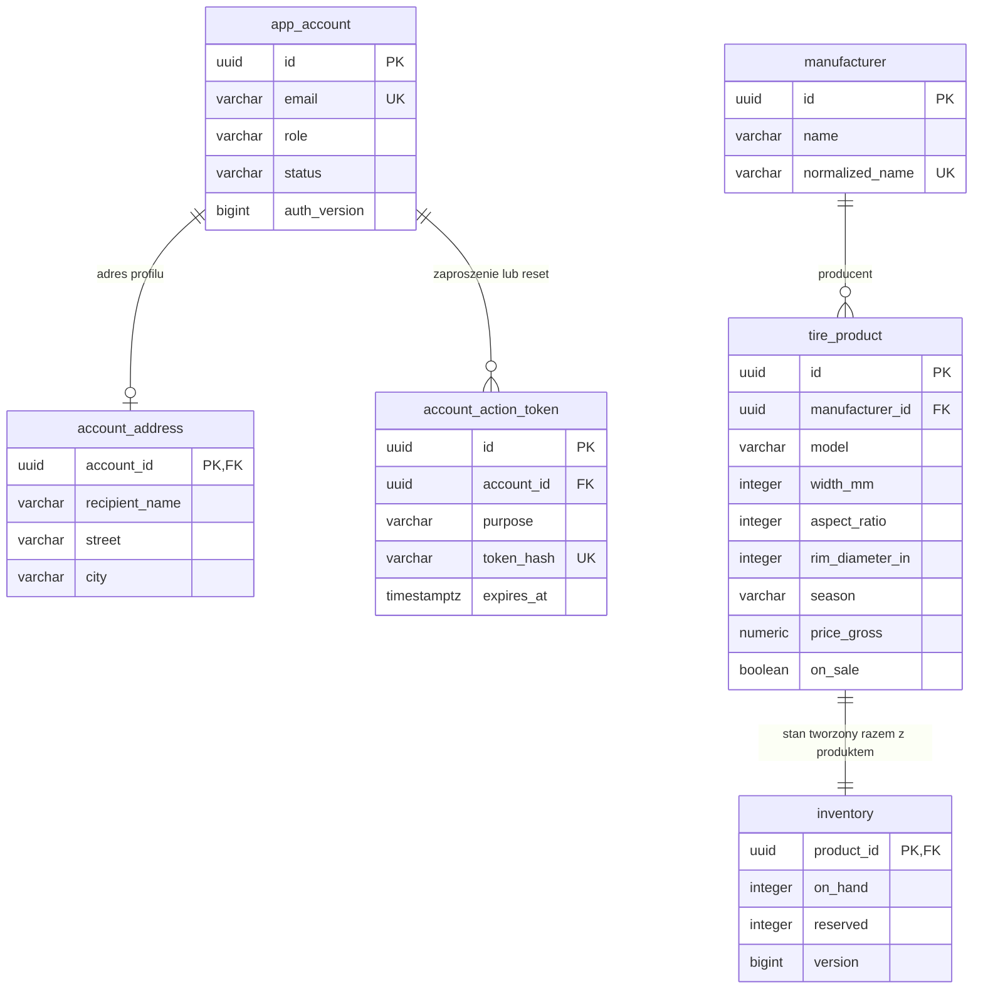
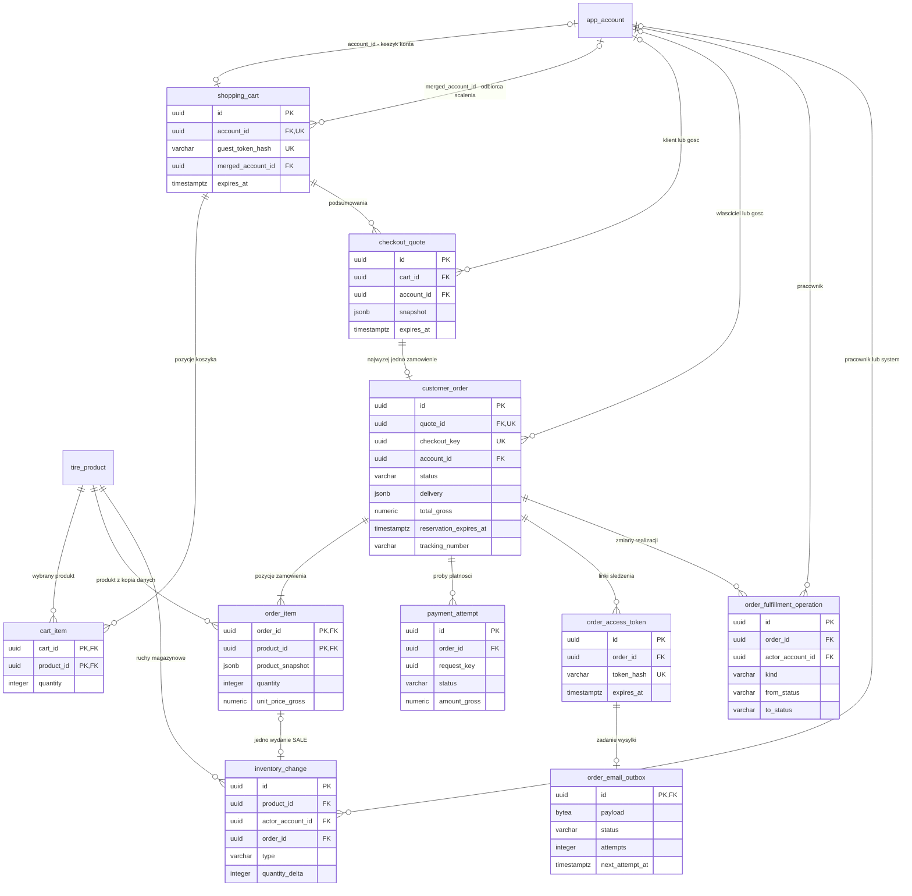
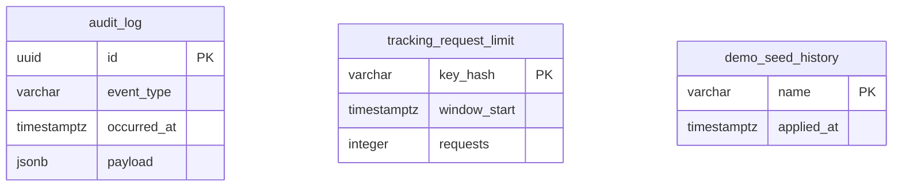

# TireShop — aktualny model danych (ERD)

[Powrót do README](../README.md)

Model odpowiada migracjom **V1–V11** w [backend/src/main/resources/db/migration](../backend/src/main/resources/db/migration). Obejmuje **19 tabel aplikacji**; nie liczymy technicznej tabeli Flyway. Tabele sesji z V2 zostały usunięte przez V3, ponieważ logowanie korzysta z JWT.

Diagram podzielono na obszary dla czytelności; powtórzona nazwa oznacza tę samą tabelę. Pokazano wybrane pola, klucze i powiązania. `PK` oznacza klucz główny, `FK` obcy, `UK` unikalny. `||` oznacza dokładnie jeden, `o|` zero lub jeden, `o{` zero lub wiele, a `|{` jeden lub wiele. Złożony PK tworzą wspólnie pola oznaczone `PK` w jednej tabeli.

### Konta, katalog i stan magazynowy

Produkt ma jeden stan magazynowy tworzony przez serwis w tej samej transakcji. Dostępność to `on_hand - reserved`; ograniczenie bazy pilnuje `0 <= reserved <= on_hand`. Ten sam wariant producenta, modelu, rozmiaru i sezonu nie może wystąpić drugi raz. Cena może być nieustalona, ale dopuszczenie do sprzedaży wymaga ceny dodatniej.

### Koszyk, zamówienie, płatności i realizacja

Koszyk i zamówienie gościa nie mają właściciela w `app_account`; dostęp opiera się na osobnych losowych tokenach. `merged_account_id` zachowuje wynik scalenia koszyka gościa, aby ponowienie nie podwajało ilości. Zamówienie zawiera co najmniej jedną pozycję, co egzekwuje logika zakupu. Para `(order_id, product_id)` w `inventory_change` jest złożonym FK do `order_item` i jest unikalna dla wydania po zapłacie. Przyjęcia i korekty nie mają `order_id`, a wydanie systemowe nie ma `actor_account_id`.

Jedno zamówienie może mieć wiele prób płatności, ale indeksy częściowe dopuszczają najwyżej jedną próbę oczekującą i jedną udaną. `order_fulfillment_operation` zapisuje wynik operacji pracownika dla bezpiecznych ponowień; nie jest pełną historią wszystkich statusów zamówienia.

### Audyt i pozostałe tabele techniczne

Te trzy tabele nie mają FK do pozostałych tabel, dlatego nie łączymy ich sztucznymi relacjami. `audit_log` przechowuje w `payload` identyfikator zamówienia i wykonawcy oraz, przy anulowaniu, powód. `tracking_request_limit` ogranicza żądania odnowienia linku także dla nieistniejących numerów zamówień. `demo_seed_history` pamięta zastosowane wersje danych demo, aby restart ich nie odtwarzał. Historyczne decyzje projektowe opisuje [backend-design.md](backend-design.md); aktualny model podsumowuje powyższy ERD, a pełną definicję określają migracje.
